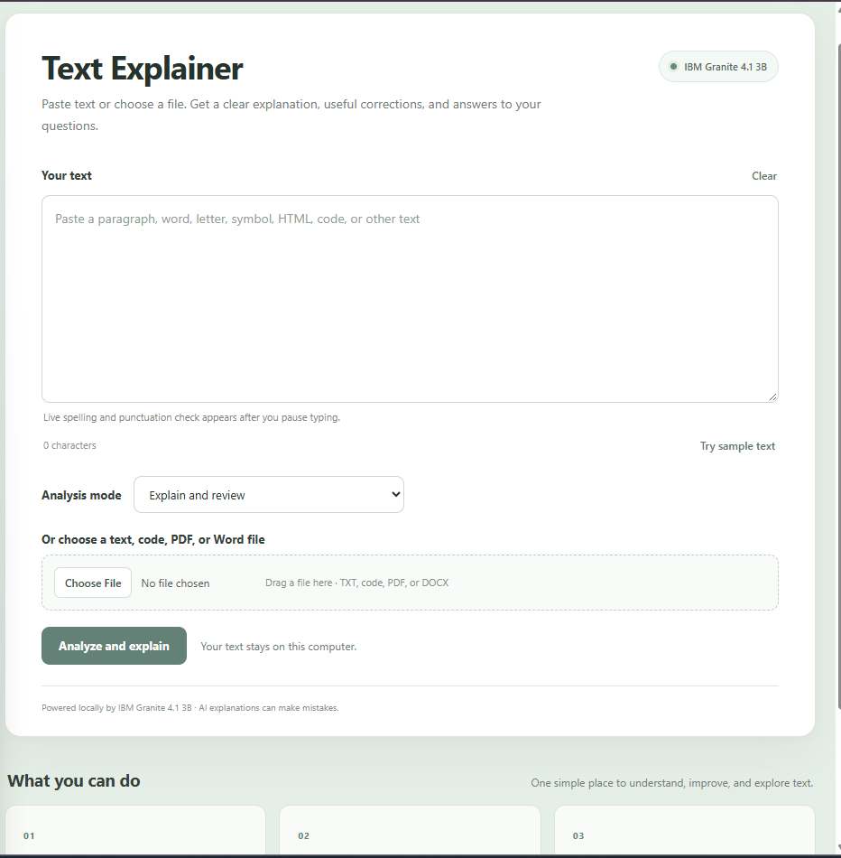
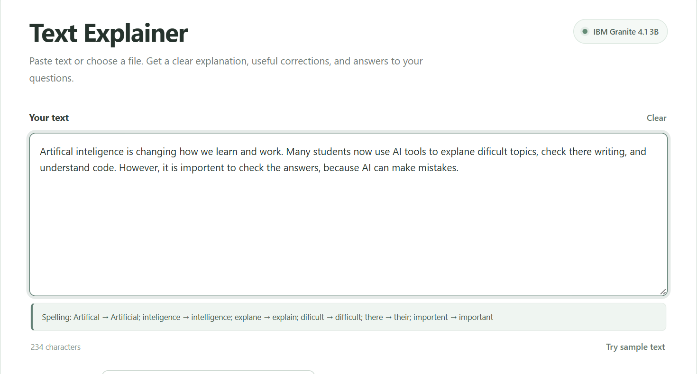
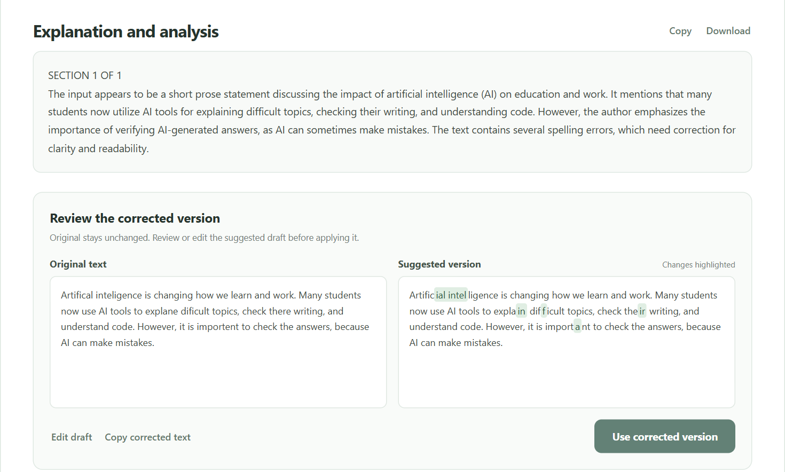
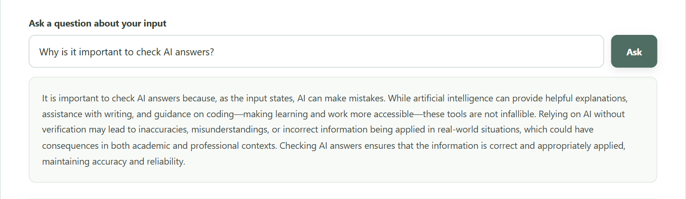
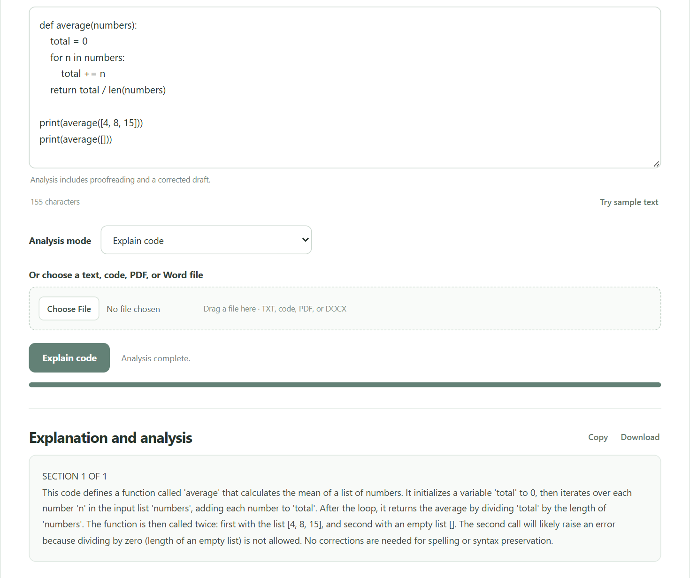
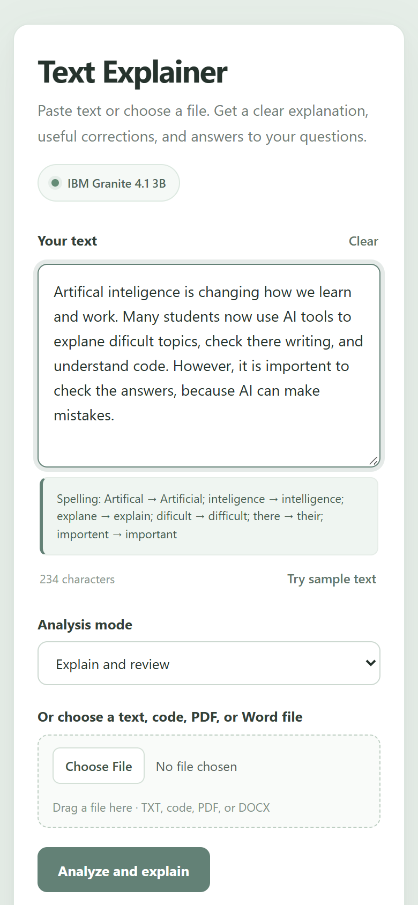

<h1 align="center">Text Explainer</h1>

<p align="center">
  <strong>Understand, proofread, and ask questions about any text, fully offline.</strong><br>
  Powered by IBM Granite 4.1 3B running locally through Ollama. Your text never leaves your computer.
</p>

<p align="center">
  <a href="https://python.org"></a>
  <a href="https://fastapi.tiangolo.com"></a>
  <a href="https://ollama.com"></a>
  <a href="https://ollama.com/library/granite4.1"></a>
  <a href="LICENSE"></a>
</p>

<p align="center">
  
</p>

---

**Text Explainer** is a small web app that explains text in plain language. Paste a paragraph, a single word, a symbol, some HTML, or a block of code, or upload a file, and it tells you what it means, points out spelling and grammar mistakes, and shows a corrected version side by side. Then you can ask follow-up questions about it.

Everything runs on your own machine. The AI model is IBM Granite 4.1 3B served by [Ollama](https://ollama.com), so there is no API key, no account, and no cloud service.

## Features

- **Three analysis modes**: *Explain and review*, *Proofread writing*, and *Explain code*
- **Live spelling and punctuation check** that runs when you pause typing
- **Side-by-side corrections**: the original text next to a suggested version with changes highlighted. You can edit the draft before you use it.
- **Follow-up questions** about the text you analyzed
- **File upload** with drag and drop: TXT, Markdown, HTML, CSS, JS/TS, Python, JSON, CSV, XML, YAML, SQL, shell scripts, **PDF**, and **Word (.docx)**
- **Long documents** are split into sections automatically, with a progress bar
- **Copy or download** the explanation as a text report
- Responsive layout that works on desktop and mobile

## Screenshots

### Live spelling check while you type
Granite flags spelling mistakes a moment after you stop typing.



### Explanation and side-by-side corrections
A plain-language explanation, then the original next to the corrected version with changes highlighted.



### Ask follow-up questions


### Explain code
In *Explain code* mode it walks through what the code does and points out likely bugs. Here it spots the divide-by-zero when the list is empty.



### Works on mobile


## How it works

```
Browser (HTML/CSS/JS)  ──►  FastAPI backend (Python)  ──►  Ollama  ──►  IBM Granite 4.1 3B
     frontend/                  backend/main.py           localhost:11434
```

The backend serves the web page, reads uploaded files (including PDF and DOCX text extraction), sends the text to Granite with a task-specific prompt, and streams progress back to the browser.

## Getting started

### 1. Install the requirements

- [Python 3.10 or newer](https://www.python.org/downloads/)
- [Ollama](https://ollama.com/download)

### 2. Download the Granite model

```bash
ollama pull granite4.1:3b
```

The model is about 2 GB.

### 3. Get the code and install the Python packages

```bash
git clone https://github.com/Karthigamurugadoss/text-explainer.git
cd text-explainer
pip install -r requirements.txt
```

### 4. Start the app

Make sure Ollama is running (it usually starts on its own after you install it), then run:

```bash
python -m uvicorn main:app --app-dir backend --port 8000
```

Open **http://localhost:8000** in your browser.

## Configuration

Optional environment variables:

| Variable | Default | Purpose |
| --- | --- | --- |
| `OLLAMA_MODEL` | `granite4.1:3b` | Use a different Ollama model |
| `OLLAMA_URL` | `http://localhost:11434/api/chat` | Point to Ollama on another address |

Example (PowerShell):

```powershell
$env:OLLAMA_MODEL = "granite4.1:8b"
python -m uvicorn main:app --app-dir backend --port 8000
```

## Project structure

```
text-explainer/
├── backend/
│   └── main.py          # FastAPI server, file reading, prompts, Ollama calls
├── frontend/
│   ├── index.html       # Page layout
│   ├── style.css        # Styling
│   └── app.js           # Interactivity, streaming progress, corrections view
├── docs/screenshots/
├── requirements.txt
└── LICENSE
```

## Limitations

- Granite 4.1 3B is a small model. It is fast and runs on an ordinary laptop, but it can miss mistakes or explain things incorrectly. Always review its suggestions.
- Scanned PDFs (images of text) are not supported. The PDF must contain selectable text.
- Speed depends on your computer. Long documents are processed one section at a time.

## License

[MIT](LICENSE) © 2026 Karthigamurugadoss

IBM Granite is a trademark of IBM. This is an independent project and is not affiliated with IBM or Ollama.
